# UML Sequence Diagrams — ZEPHYR Project

## 1. Регистрация пользователя

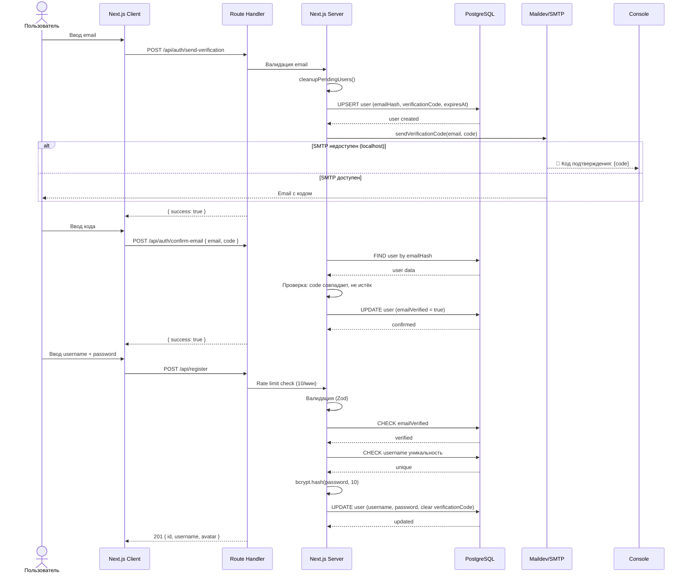

## 2. Аутентификация (Login/JWT)

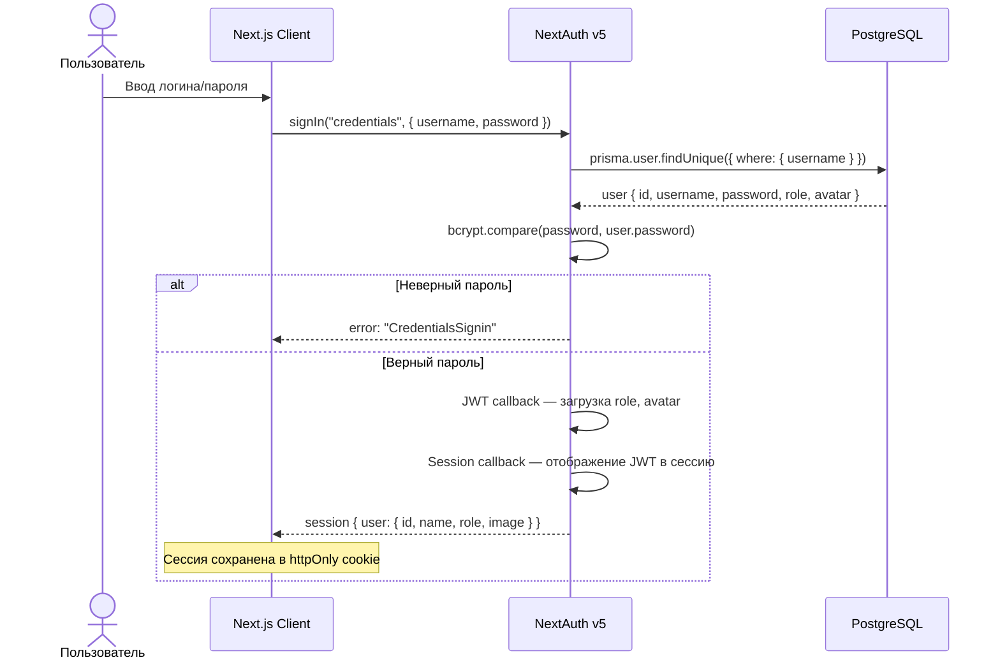

## 3. Создание поста с хэштегами

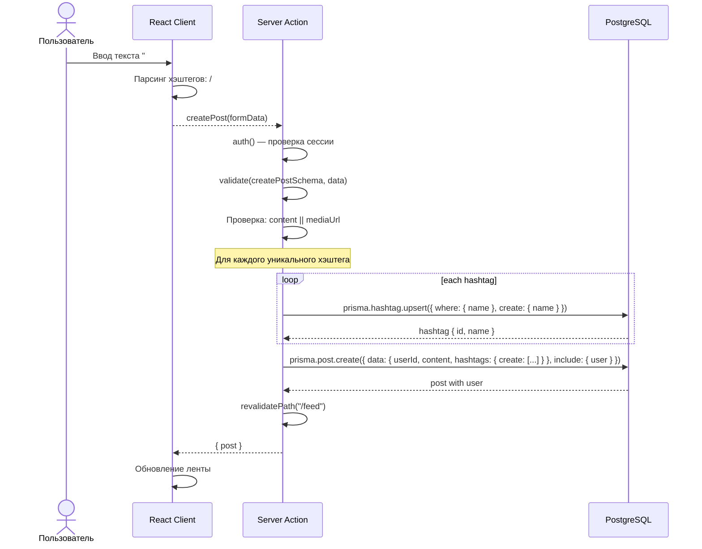

## 4. Лайк поста + уведомление

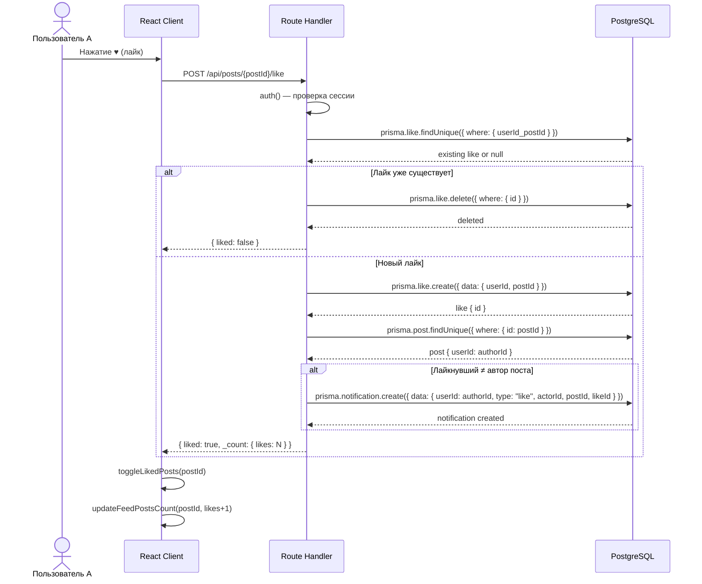

## 5. Комментарий + уведомление

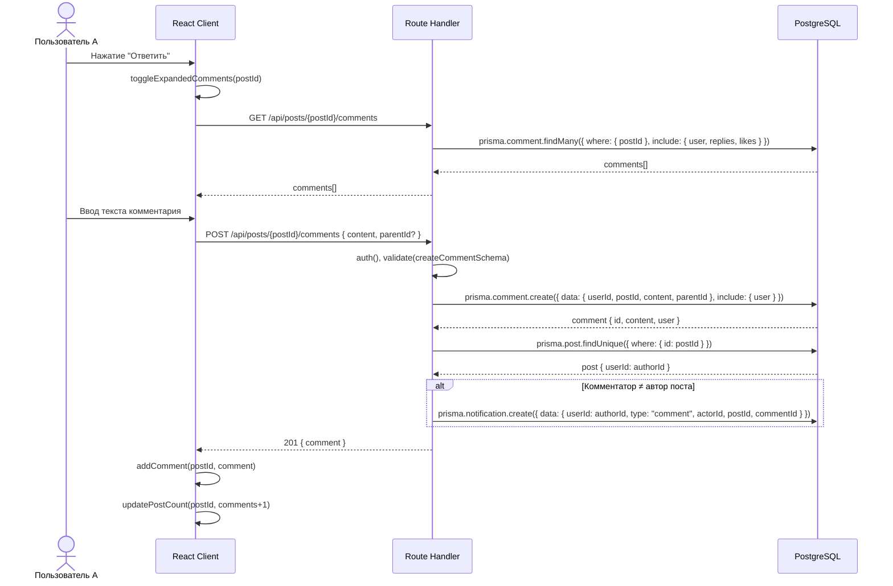

## 6. Подписка на пользователя

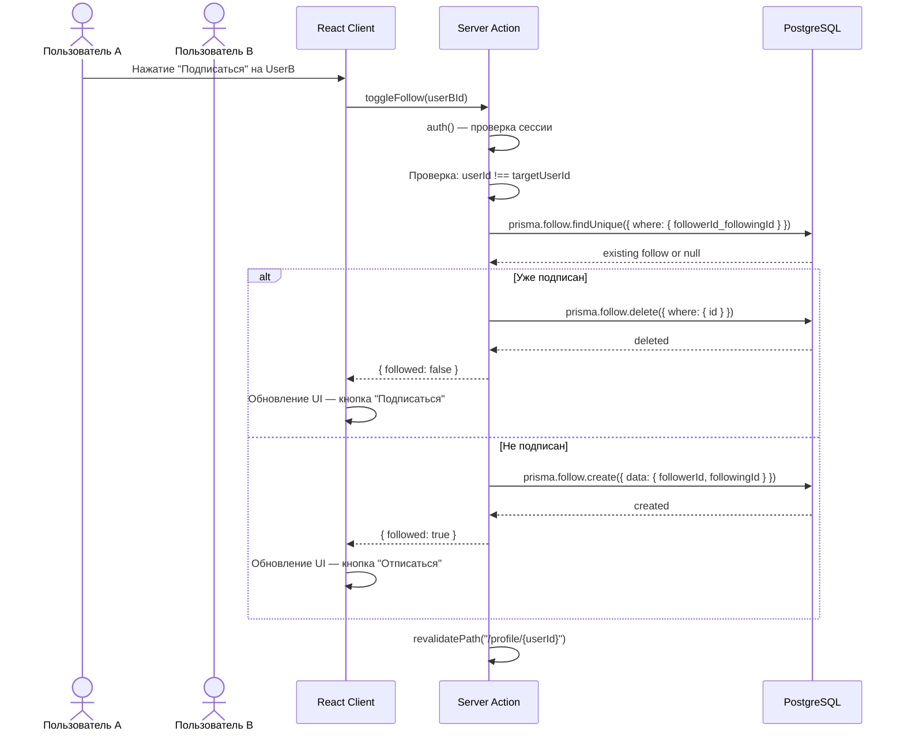

## 7. Отправка сообщения (Optimistic UI + Socket.IO)

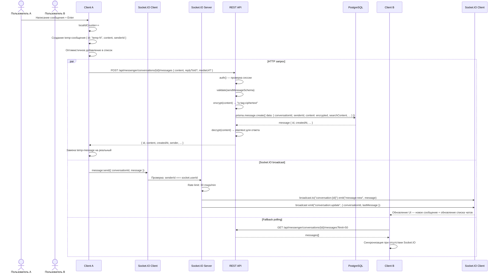

## 8. Статус "печатает" (Typing Indicator)

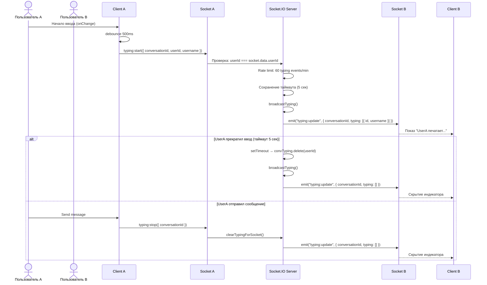

## 9. Онлайн-статус

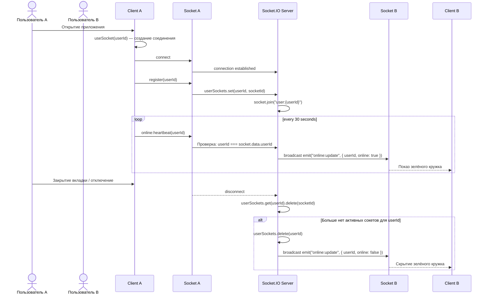

## 10. Реакция на сообщение

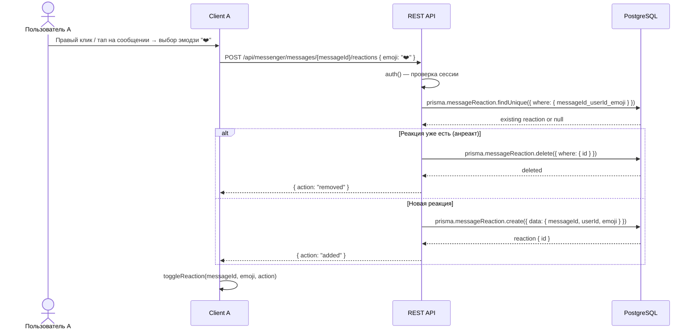

## 11. Закрепление сообщения (Pin)

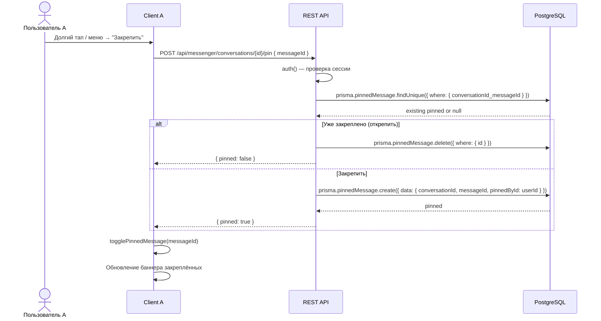

## 12. Админ-панель: управление пользователями

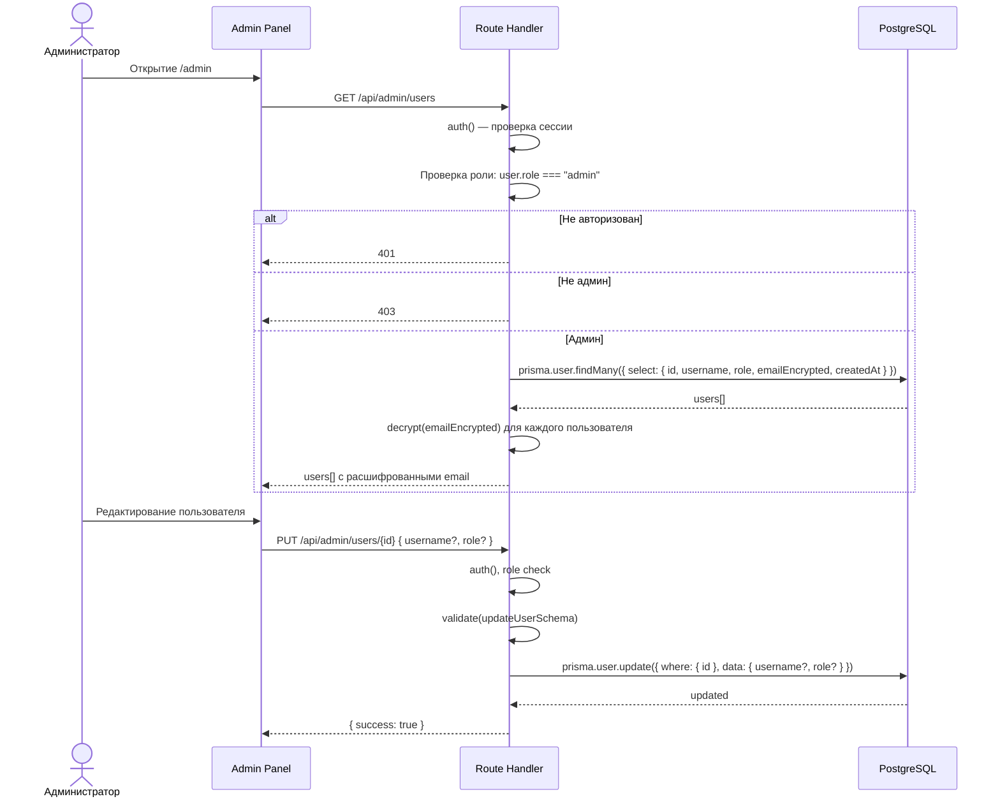

## 13. Загрузка и просмотр изображений

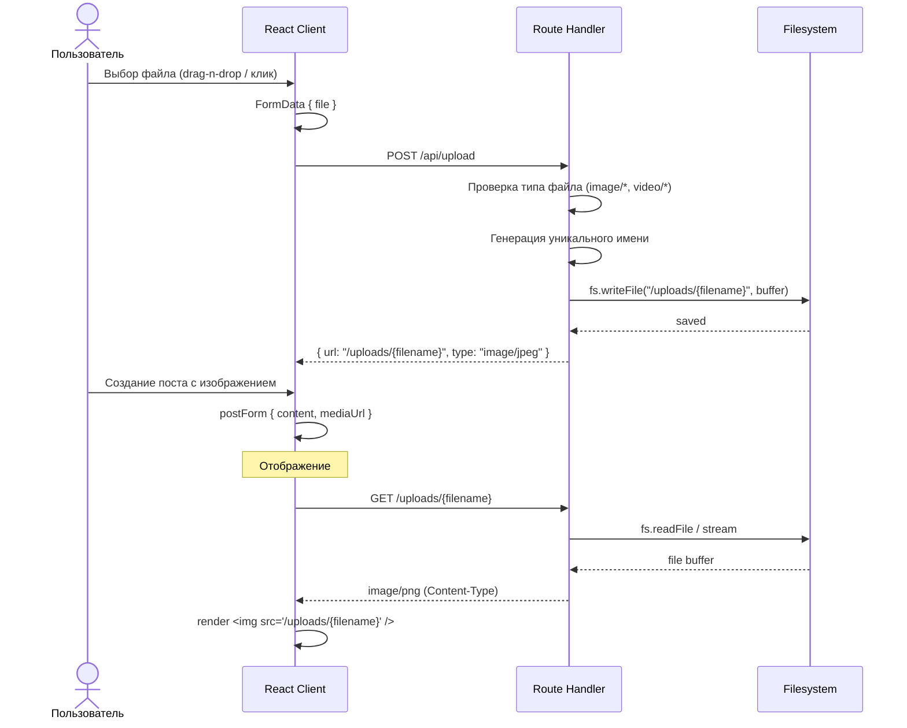

## 14. Release Notes (заметки обновлений)

```mermaid
sequenceDiagram
    actor Admin as Администратор
    visitor User as Пользователь
    participant Client as React Client
    participant API as Route Handler
    participant DB as PostgreSQL

    Admin->>Client: Создание release note
    Client->>API: POST /api/admin/release-notes { title, content }
    API->>API: auth(), role === "admin"
    API->>API: validate(releaseNoteSchema)
    API->>DB: prisma.releaseNote.create({ data: { title, content } })
    DB-->>API: releaseNote { id, title, content, createdAt }
    API-->>Client: 201 { releaseNote }
    
    User->>Client: Открытие /updates
    Client->>API: GET /api/release-notes
    API->>DB: prisma.releaseNote.findMany({ orderBy: { createdAt: "desc" } })
    DB-->>API: releaseNotes[]
    API-->>Client: releaseNotes[]

    Admin->>Client: Редактирование
    Client->>API: PUT /api/admin/release-notes/{id} { title, content }
    API->>DB: prisma.releaseNote.update({ where: { id }, data: { title, content } })
    DB-->>API: updated
    API-->>Client: { releaseNote }
```

## 15. Блокировка пользователя (мессенджер)

```mermaid
sequenceDiagram
    actor UserA as Пользователь A
    participant Client as React Client
    participant API as Route Handler
    participant DB as PostgreSQL

    UserA->>Client: Меню пользователя → "Заблокировать"
    Client->>API: POST /api/messenger/block { userId: "userB-id" }
    API->>API: auth() — проверка сессии
    API->>API: validate(blockUserSchema)
    
    API->>DB: prisma.userBlock.findUnique({ where: { blockerId_blockedId } })
    DB-->>API: existing block or null
    
    alt Уже заблокирован (разблокировать)
        API->>DB: prisma.userBlock.delete({ where: { id } })
        DB-->>API: deleted
        API-->>Client: { blocked: false }
    else Заблокировать
        API->>DB: prisma.userBlock.create({ data: { blockerId, blockedId } })
        DB-->>API: block created
        API-->>Client: { blocked: true }
    end
    
    Client->>Client: Обновление UI
    Note over Client: Заблокированный пользователь:<br/>- не видит сообщения от блокирующего<br/>- не может писать в общий чат